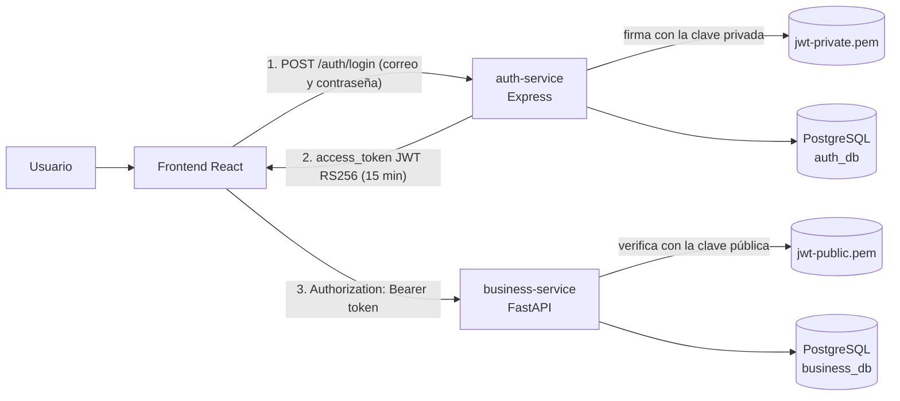
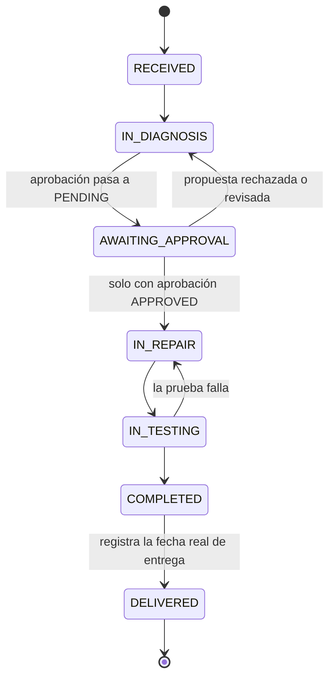
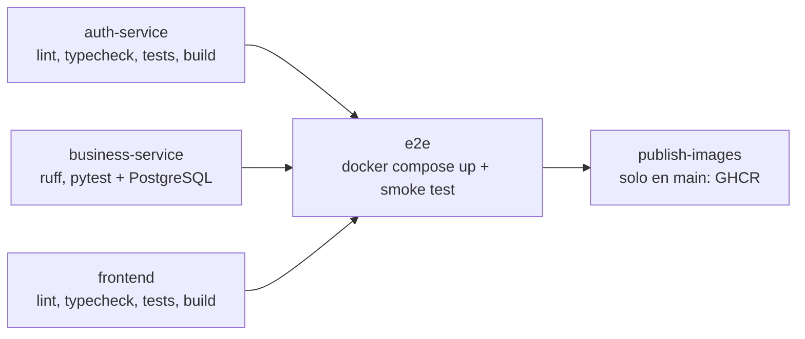

# Plataforma de gestión de reparaciones de motores

Aplicación interna para un taller que repara motores de maquinaria de minería pesada. Permite registrar
clientes y motores, crear órdenes de reparación, seguir su avance por estados con historial y administrar
usuarios con roles.

La solución está dividida en dos APIs independientes y un frontend:

| Componente | Tecnología | Responsabilidad | Puerto local |
|---|---|---|---|
| [`auth-service/`](auth-service/README.md) | Node.js, Express, TypeScript | Usuarios, contraseñas (Argon2id), roles, login y emisión de JWT RS256 | 3001 |
| [`business-service/`](business-service/README.md) | Python, FastAPI, SQLModel, Alembic | Clientes, motores, órdenes, aprobación e historial de estados; valida el JWT | 8000 |
| [`frontend/`](frontend/README.md) | React, TypeScript, Vite | Login, dashboard, clientes, motores, órdenes, detalle y usuarios | 5173 |
| PostgreSQL 16 | Una base por servicio: `auth_db` y `business_db` | Persistencia | 5432 |

## Cómo funciona y cómo se conecta todo



1. **Inicio de sesión.** El frontend envía el correo y la contraseña **solo** a `auth-service`. Este busca
   al usuario en `auth_db`, compara la contraseña con su hash Argon2id y, si el usuario está activo,
   devuelve un JWT firmado con **RS256** usando la clave **privada**. El token incluye `sub` (id del
   usuario), `role` (`ADMIN` u `OPERATOR`), `iss`, `aud`, `iat`, `exp` (15 minutos), `jti` y en la
   cabecera `kid`.
2. **Sesión en el navegador.** El frontend guarda el token en `sessionStorage` (solo esa pestaña), pide el
   perfil con `GET /auth/me` y cierra la sesión automáticamente cuando el token vence o cuando una API
   responde `401`.
3. **Operaciones de negocio.** Cada petición a `business-service` lleva `Authorization: Bearer <token>`.
   FastAPI **no decodifica a ciegas**: verifica la firma con la clave **pública**, exige `RS256`, valida
   `exp`, `iss`, `aud`, la presencia de `sub`, `iat`, `exp` y `jti`, que `sub` sea un UUID y que el rol sea
   válido. Si algo falla responde `401`.
4. **Separación de responsabilidades.** `business-service` no guarda contraseñas ni tiene login, y no
   puede emitir tokens porque solo tiene la clave pública. Ningún servicio lee las tablas del otro: cada
   uno tiene su base de datos y su propio usuario de PostgreSQL, sin permiso de conexión a la base ajena.
   El único contrato compartido es el JWT. Las referencias a usuarios en el negocio (por ejemplo, quién
   cambió un estado) son UUID sin llave foránea.
5. **Ciclo de vida de una orden.** Al crearla se toma el cliente del dueño del motor, se genera el número
   `REP-<año>-<000001>` con una secuencia de PostgreSQL y se registra el estado `RECEIVED` en el historial.
   Cada cambio de estado se valida en el dominio y se guarda junto con su fila de historial en la misma
   transacción:



| Estado | En la interfaz |
|---|---|
| `RECEIVED` | Recibido |
| `IN_DIAGNOSIS` | En diagnóstico |
| `AWAITING_APPROVAL` | Esperando aprobación |
| `IN_REPAIR` | En reparación |
| `IN_TESTING` | En pruebas |
| `COMPLETED` | Finalizado |
| `DELIVERED` | Entregado |

## Ejecutar todo con Docker Compose

Requisitos: Docker con Compose v2.

```bash
cp .env.example .env        # opcional: cambia contraseñas y el admin inicial
docker compose up -d
```

Las imágenes de la aplicación siempre se construyen desde el código (`pull_policy: build`), así que Compose
no intenta descargarlas de ningún registro. La primera vez tarda unos minutos porque instala dependencias;
las siguientes reutilizan la caché y arrancan en segundos. Para ver el estado: `docker compose ps`.

Al arrancar, Compose:

1. Inicia PostgreSQL y, la primera vez, ejecuta `docker/postgres/init-databases.sh`, que crea `auth_db` y
   `business_db`, cada una con su propio usuario.
2. Ejecuta el job `jwt-keys`, que genera el par de llaves RS256 si no existe. La privada queda en un volumen
   que solo monta `auth-service`; la pública, en otro que solo monta `business-service`.
3. Arranca `auth-service`: aplica sus migraciones SQL, crea el primer administrador (solo si no hay ninguno
   activo) y queda escuchando.
4. Arranca `business-service`: aplica las migraciones de Alembic y queda escuchando.
5. Sirve el frontend compilado con nginx.

| Qué | URL |
|---|---|
| Aplicación web | http://localhost:5173 |
| Swagger de auth-service | http://localhost:3001/api/v1/docs |
| Swagger de business-service | http://localhost:8000/api/v1/docs |

Usuario inicial (valores de `.env.example`): `admin@example.com` / `ChangeMe-Admin-2026`. Desde la vista
**Usuarios** el administrador crea operadores; no existe registro público.

Prueba de punta a punta contra el stack levantado:

```bash
./scripts/smoke-test.sh
```

Para detener todo y borrar los datos: `docker compose down -v`.

## Ejecutar cada servicio sin Docker

Necesitas Node.js 22, Python 3.12 con [uv](https://docs.astral.sh/uv/) y un PostgreSQL con las dos bases
(puedes reutilizar `docker/postgres/init-databases.sh`).

```bash
# 1. auth-service
cd auth-service && npm install && cp .env.example .env
npm run keys:generate && npm run db:migrate && npm run admin:bootstrap && npm run dev

# 2. business-service (otra terminal)
cd business-service && uv sync && cp .env.example .env   # JWT_PUBLIC_KEY_PATH apunta a la llave pública de auth
uv run alembic upgrade head && uv run uvicorn business_service.main:app --reload --port 8000

# 3. frontend (otra terminal)
cd frontend && npm install && cp .env.example .env && npm run dev
```

## Pruebas y calidad

| Componente | Comandos | Qué cubre |
|---|---|---|
| auth-service | `npm run lint`, `npm run typecheck`, `npm test`, `npm run build` | Servicios con repositorios en memoria, JWT (claims, firma, expiración) y la API HTTP con Supertest |
| business-service | `uv run ruff check .`, `uv run ruff format --check .`, `uv run pytest` | Reglas del dominio, casos de uso, flujo HTTP completo, rechazo de tokens inválidos y, con `TEST_DATABASE_URL`, el flujo contra PostgreSQL con Alembic |
| frontend | `npm run lint`, `npm run typecheck`, `npm test`, `npm run build` | Validación de formularios, expiración de sesión y flujo de login con Testing Library |
| Todo junto | `./scripts/smoke-test.sh` | Login real, token en la API de negocio, token alterado rechazado y ciclo completo de una orden |

## CI/CD con GitHub Actions

El flujo [`.github/workflows/ci.yml`](.github/workflows/ci.yml) corre en cada pull request y en cada push a
`main`:



- Los tres primeros jobs corren en paralelo. `business-service` usa un contenedor de PostgreSQL para la
  prueba de integración.
- `e2e` construye las imágenes, levanta el stack completo como entorno de pruebas y ejecuta
  `scripts/smoke-test.sh`. Si falla, muestra los logs.
- `publish-images` solo corre en `main` y publica las tres imágenes en GitHub Container Registry
  (`ghcr.io/<owner>/assesstment-engine-repair/<servicio>`) con la etiqueta del commit y `latest`.

Ningún secreto vive en el repositorio. Las pruebas generan llaves temporales y el registro usa el
`GITHUB_TOKEN` del propio flujo. La evidencia de ejecución queda en la pestaña **Actions** del repositorio.

## Seguridad

- Contraseñas con Argon2id. Nunca se devuelven ni se registran en logs.
- JWT RS256 con lista explícita de algoritmos: se rechazan `alg: none` y tokens firmados con otra llave.
- Autorización en el backend: la gestión de usuarios es solo para `ADMIN`. Ocultar opciones en el frontend
  es solo comodidad.
- Errores en formato `application/problem+json` (RFC 9457), sin trazas, SQL ni detalles internos.
- Los cuerpos de las peticiones rechazan campos desconocidos (`422`).
- `.env` y `*.pem` están en `.gitignore`. Solo se versionan los `.env.example` con valores de ejemplo.
- Integridad garantizada también en la base: documento de cliente único, serie de motor única, número de
  orden único, llave foránea compuesta orden → (motor, cliente) y `CHECK` para estados válidos.

## Estructura del repositorio

```text
.
├── auth-service/          # Express + TypeScript (capas domain, application, infrastructure, presentation)
├── business-service/      # FastAPI + Clean Architecture, Alembic, pruebas unitarias, API e integración
├── frontend/              # React + TypeScript (Vite), nginx para producción
├── docker/                # Init de PostgreSQL y generador de llaves JWT
├── scripts/smoke-test.sh  # Prueba de punta a punta
├── docs/                  # Arquitectura, modelo de datos, contrato de API, ADRs y plan
├── .github/workflows/     # Pipeline de CI/CD
├── docker-compose.yml
└── .env.example
```

## Documentación técnica

- [Arquitectura](docs/architecture.md): servicios, capas, persistencia y manejo de llaves por entorno.
- [Modelo de datos](docs/data-model.md): tablas, relaciones, restricciones y transiciones de estado.
- [Contrato de API](docs/api-contract.md): endpoints, claims del JWT, roles, filtros y formato de errores.
- [Decisiones (ADR)](docs/decisions.md): aprobación en la orden, usuarios creados solo por un administrador
  y límites entre servicios.
- [Plan](docs/initial-plan.md): escenario de aceptación y estado de los entregables.
