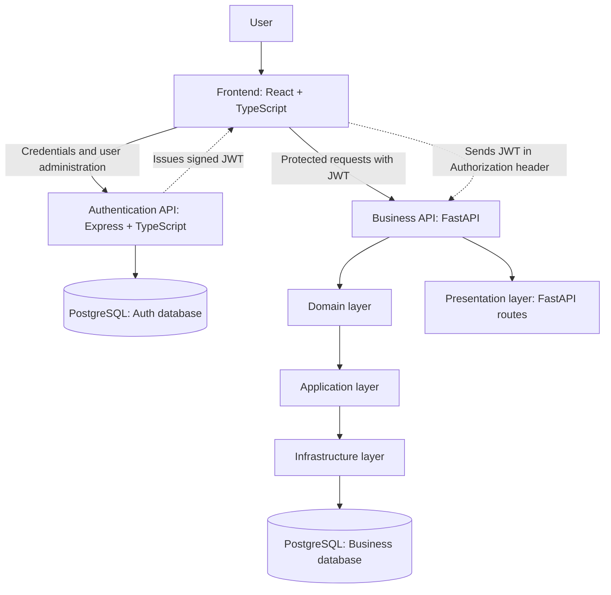

# System Architecture

## 1. Purpose and scope

This document records the approved initial architecture for the Engine Repair Assessment. It describes responsibilities and service boundaries only; it does not initialize application projects or implement application code.

## 2. Technology stack

| Component | Technology | Responsibility |
|---|---|---|
| Frontend | React + TypeScript | User interface and API consumption |
| Authentication API | Node.js + Express + TypeScript | Users, password hashes, roles, login, and JWT issuance |
| Business API | Python + FastAPI | Clients, engines, repair orders, status transitions, and history |
| Business persistence | PostgreSQL + SQLModel | Persist business data |
| Migrations | Alembic | Version and apply database schema changes |
| Python environment and dependencies | UV | Manage the virtual environment, dependencies, and Python commands |
| Local orchestration | Docker Compose | Run application services and PostgreSQL locally |
| CI | GitHub Actions | Automated checks and tests |

## 3. Logical architecture



The diagram is a logical view. In Clean Architecture, dependencies must point inward: infrastructure and presentation may depend on application/domain abstractions, but domain rules must not depend on FastAPI, SQLModel, Alembic, or PostgreSQL.

## 4. Service boundaries

### 4.1 Authentication service

Owns:
- User registration and administration.
- Password hashing and credential verification.
- User roles and active/inactive status.
- Login and issuance of signed JWTs.

It must never store plaintext passwords. It owns its persistence and does not expose its internal user tables to the business service.

### 4.2 Business service

Owns:
- Clients and their identification/contact data.
- Engines and client ownership.
- Repair orders and their lifecycle.
- Repair status history.
- Business validation and protected business endpoints.

It validates JWTs issued by the authentication service. It must verify the signature, expiry, and required claims; decoding a token alone is not authentication. It does not implement password login or read the authentication database.

### 4.3 Frontend

Owns:
- Login and navigation screens.
- Forms, tables, loading states, and user-facing errors.
- Calls to both APIs.
- Sending the access token on protected business requests.

Frontend role-based navigation is a usability feature, not a security boundary. The APIs must enforce authorization independently.

## 5. Authentication and JWT flow

1. The user submits credentials through the frontend.
2. The frontend sends credentials to the authentication API.
3. The authentication API verifies the password hash and issues a signed JWT.
4. The frontend sends the token to protected business endpoints using the `Authorization: Bearer <token>` header.
5. FastAPI verifies the signature, expiry, and required claims before invoking the relevant use case.
6. The business service applies authorization rules and performs the requested operation.

### Signing algorithm

The proposed approach is RS256: the authentication service holds the private signing key and FastAPI receives only the corresponding public verification key. This separates the ability to issue tokens from the ability to verify them. Both services must explicitly configure the expected algorithm and validate required claims.

The token contract must document the issuer, audience (if used), subject, role/permissions as needed, expiry, and key configuration. Secrets and private keys must be supplied through environment-specific secret management and must never be committed to Git.

## 6. PostgreSQL ownership

Use one PostgreSQL server for local development with two separate databases:
- Authentication database, owned by the authentication service.
- Business database, owned by the business service.

Each service uses its own database credentials and may access only its own database. The business service must not query the authentication service's internal tables. This keeps service ownership clear while avoiding unnecessary local infrastructure.

## 7. Clean Architecture in the FastAPI service

Suggested package layout:

```text
business-service/
├── pyproject.toml
├── uv.lock
├── alembic.ini
├── alembic/
│   ├── env.py
│   └── versions/
├── src/
│   └── business_service/
│       ├── main.py
│       ├── domain/
│       │   ├── entities/
│       │   ├── value_objects/
│       │   ├── repositories/
│       │   └── exceptions/
│       ├── application/
│       │   ├── dto/
│       │   ├── use_cases/
│       │   └── services/
│       ├── infrastructure/
│       │   ├── database/
│       │   │   ├── models/
│       │   │   ├── session.py
│       │   │   └── repositories/
│       │   ├── security/
│       │   └── config/
│       └── presentation/
│           └── api/
│               ├── dependencies/
│               ├── routes/
│               └── schemas/
└── tests/
    ├── unit/
    ├── integration/
    └── api/
```

Layer responsibilities:

- **Domain:** business entities, value objects, repository abstractions, and domain rules. No framework or persistence dependencies.
- **Application:** use cases, DTOs, and orchestration of business operations.
- **Infrastructure:** SQLModel persistence models, repository implementations, database sessions, JWT verification implementation, and configuration.
- **Presentation:** FastAPI routes, request/response schemas, dependency wiring, and HTTP error mapping.

Domain entities and SQLModel persistence models should be kept conceptually separate where this helps preserve the dependency rule. Mapping between them belongs outside the domain layer.

## 8. SQLModel, Alembic, and UV

- SQLModel is used for persistence models and typed database access.
- Alembic owns schema migrations. Migration files must be reviewed and versioned.
- Alembic must be configured to load the SQLModel metadata for all persistence models.
- UV manages the Python project, dependency lockfile, virtual environment, and execution of development tools.
- Alembic migrations, rather than `SQLModel.metadata.create_all()`, are the normal schema setup mechanism for this project.

## 9. Initial implementation sequence

1. Confirm the domain model and API contracts.
2. Initialize the three application projects (not part of this documentation-only stage).
3. Configure PostgreSQL ownership, settings, and migrations.
4. Implement authentication, JWT issuance, and tests.
5. Implement business use cases, repositories, JWT verification, and tests.
6. Integrate the frontend.
7. Add Docker Compose, GitHub Actions, and end-to-end checks.
8. Finish the runbook and technical documentation.

## 10. Security and operational principles

- Never commit credentials, access tokens, private keys, or real environment files.
- Keep a placeholder-only `.env.example`.
- Validate authorization in backend endpoints; never rely only on frontend controls.
- Enforce uniqueness and referential integrity in the database as well as validating requests in the application.
- Use migrations for schema changes and test them against a clean database.
