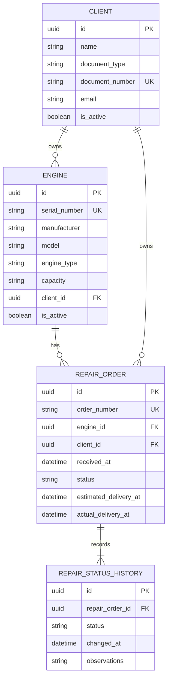

# Business Data Model

## 1. Scope and ownership

This document defines the initial relational model for the Engine Repair Assessment.

The model is split by service ownership:
- **Authentication database:** `users`, owned exclusively by the Express authentication service.
- **Business database:** `clients`, `engines`, `repair_orders`, and `repair_status_history`, owned exclusively by the FastAPI business service.

No cross-database foreign key is created between users and business tables.

## 2. Entities and fields

The following field types are logical PostgreSQL recommendations. Exact SQLModel declarations, nullability, indexes, and migration details will be finalized during implementation.

### 2.1 `users` — authentication database

| Field | Suggested type | Rule / purpose |
|---|---|---|
| `id` | UUID | Primary key |
| `name` | VARCHAR | Required |
| `email` | VARCHAR | Required; unique |
| `password_hash` | VARCHAR | Required; secure password hash only |
| `role` | VARCHAR or PostgreSQL ENUM | Required; initial roles: `ADMIN`, `OPERATOR` |
| `is_active` | BOOLEAN | Required; default true |
| `created_at` | TIMESTAMPTZ | Creation timestamp |
| `updated_at` | TIMESTAMPTZ | Last update timestamp |

Email uniqueness should be enforced in the database. Passwords must never be stored in plaintext.

### 2.2 `clients` — business database

| Field | Suggested type | Rule / purpose |
|---|---|---|
| `id` | UUID | Primary key |
| `name` | VARCHAR | Required |
| `document_type` | VARCHAR | Required |
| `document_number` | VARCHAR | Required |
| `email` | VARCHAR | Contact information; nullability to be confirmed |
| `is_active` | BOOLEAN | Required; default true |
| `created_at` | TIMESTAMPTZ | Creation timestamp |
| `updated_at` | TIMESTAMPTZ | Last update timestamp |

Integrity rule: the pair `(document_type, document_number)` must be unique.

### 2.3 `engines` — business database

| Field | Suggested type | Rule / purpose |
|---|---|---|
| `id` | UUID | Primary key |
| `serial_number` | VARCHAR | Required; unique |
| `manufacturer` | VARCHAR | Required |
| `model` | VARCHAR | Required |
| `engine_type` | VARCHAR | Required |
| `capacity` | VARCHAR | Capacity/specification with units, if applicable |
| `client_id` | UUID | Required foreign key to `clients.id` |
| `registered_at` | TIMESTAMPTZ | Registration timestamp |
| `is_active` | BOOLEAN | Required; default true |
| `created_at` | TIMESTAMPTZ | Creation timestamp |
| `updated_at` | TIMESTAMPTZ | Last update timestamp |

Integrity rules:
- `serial_number` must be unique.
- `client_id` must reference an existing client.
- Prefer logical deactivation over physical deletion when records are referenced by repair orders.

### 2.4 `repair_orders` — business database

| Field | Suggested type | Rule / purpose |
|---|---|---|
| `id` | UUID | Primary key |
| `order_number` | VARCHAR | Required; unique |
| `engine_id` | UUID | Required foreign key to `engines.id` |
| `client_id` | UUID | Required foreign key to `clients.id` |
| `received_at` | TIMESTAMPTZ | Required |
| `reported_problem` | TEXT | Required |
| `technical_diagnosis` | TEXT | Optional until diagnosed |
| `repair_description` | TEXT | Optional until work is defined/performed |
| `technician_name` | VARCHAR | Technician reference; can be plain text for the initial scope |
| `estimated_delivery_at` | TIMESTAMPTZ | Optional |
| `actual_delivery_at` | TIMESTAMPTZ | Optional until delivered |
| `status` | VARCHAR or PostgreSQL ENUM | Required current status |
| `observations` | TEXT | Optional |
| `created_at` | TIMESTAMPTZ | Creation timestamp |
| `updated_at` | TIMESTAMPTZ | Last update timestamp |

The model retains both `engine_id` and `client_id` to represent the requested order details. The application and database must prevent an order from referencing a client different from the engine's owner. One robust relational approach is a composite foreign key from `(engine_id, client_id)` to a matching unique pair on `engines`; another implementation may use an equivalent explicit integrity mechanism. This constraint must not be left solely to frontend validation.

### 2.5 `repair_status_history` — business database

| Field | Suggested type | Rule / purpose |
|---|---|---|
| `id` | UUID | Primary key |
| `repair_order_id` | UUID | Required foreign key to `repair_orders.id` |
| `status` | VARCHAR or PostgreSQL ENUM | Required status recorded |
| `changed_at` | TIMESTAMPTZ | Required timestamp |
| `observations` | TEXT | Optional note explaining the transition |

Each status transition creates a new history row. Historical records should not be overwritten when the current status changes.

## 3. Relationships

The `users` entity is intentionally omitted from this business ER diagram because it belongs to the separate authentication database.

## 4. Initial repair statuses

Use a controlled set of status values corresponding to the repair lifecycle:

1. `RECEIVED` — received.
2. `IN_DIAGNOSIS` — in diagnosis.
3. `AWAITING_APPROVAL` — awaiting approval.
4. `IN_REPAIR` — in repair.
5. `IN_TESTING` — in testing.
6. `COMPLETED` — completed.
7. `DELIVERED` — delivered.

These values are proposed stable API/database identifiers. The user interface can display localized labels. Valid transitions should be enforced in the business use case rather than allowing arbitrary status changes.

When a repair order is created, its initial status must also be inserted into `repair_status_history`. The update of the current status and insertion of the history record should occur in one database transaction.

## 5. Key constraints and integrity rules

- User email is unique in the authentication database.
- Client document type + document number is unique.
- Engine serial number is unique.
- Repair order number is unique.
- Every engine references an existing client.
- Every repair order references an existing engine and its owning client.
- Every history row references an existing repair order.
- The current order status and the new history row are updated atomically.
- Referenced business records should generally be deactivated rather than physically deleted.
- API validation provides clear errors, while database constraints remain the final integrity guard.

## 6. SQLModel and Alembic considerations

- SQLModel persistence models belong to the infrastructure layer of the FastAPI service.
- Domain entities and API schemas should not be coupled to database tables without a deliberate reason.
- Alembic migrations define and version schema changes.
- Alembic's environment must import/register every persistence model so that autogeneration can detect metadata.
- Review autogenerated migrations before applying them.
- Use UUID identifiers and timezone-aware timestamps consistently.
- Use database transactions for operations that must update multiple related rows.

## 7. Decisions to confirm during implementation

The approved conceptual design leaves these implementation details to be settled when the requirements and exact field definitions are mapped into code:
- Whether client email is required.
- Whether capacity should be numeric with a unit column or stored as a descriptive string.
- The exact allowed role values and permissions.
- The format/generation strategy for repair order numbers.
- Whether a technician remains a text reference or later becomes a separate entity.
- The exact status transition matrix and whether cancellation is required by the assessment.
